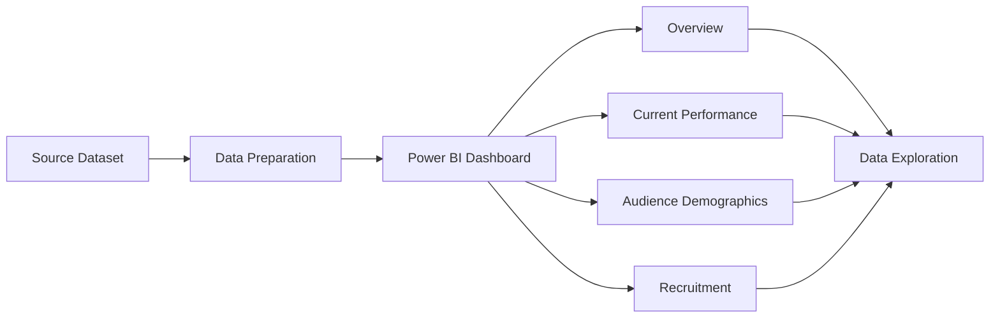

<div align="center">

# 🔗 LinkedIn Talent Analytics Dashboard


<br>


### 📊 Exploring Talent, Performance, Audience & Recruitment Data

</div>

---

# 📌 Overview

The **LinkedIn Talent Analytics Dashboard** is an interactive Power BI project designed to explore talent-related data through visualizations and organized report pages.

The dashboard presents data in a structured format, making it easier to explore performance, audience demographics, and recruitment-related information.

---

# ✨ Dashboard Features

✅ Interactive Power BI report

✅ Overview and performance analysis

✅ Audience demographics analysis

✅ Recruitment analytics

✅ Visual representation of available data

✅ Organized report pages for easier navigation

> Update these features to match the actual visuals and filters in your dashboard.

---

# 🛠️ Tools Used

- 📊 Microsoft Power BI
- 📈 Data Visualization
- 📋 Dashboard Design
- 🔎 Data Analysis

---

# 📸 Dashboard Preview

<div align="center">


</div>

---

# 📊 Dashboard Pages

### 🔹 Overview

Provides a high-level view of the information available in the dataset.

### 🔹 Current Performance

Presents performance-related information through dashboard visuals.

### 🔹 Audience Demographics

Helps explore audience and demographic attributes available in the dataset.

### 🔹 Recruitment

Presents recruitment-related information supported by the available data.

---

# 🔍 Key Insights

Add your actual findings from the dashboard here.

- 📈 **Performance Insight:** Add a verified performance finding.
- 👥 **Audience Insight:** Add a verified audience or demographic finding.
- 🎯 **Recruitment Insight:** Add a verified recruitment finding.

*Replace these examples with insights and values confirmed in Power BI.*

---

# 📂 Project Structure

```text
LinkedIn-Talent-Analytics-Dashboard/
│
├── LinkedIn-Talent-Analytics.pbix
├── Dashboard-Screenshots/
│   ├── overview.png
│   ├── current-performance.png
│   ├── audience-demographics.png
│   └── recruitment.png
│
└── README.md
```

---

# 🚀 Getting Started

### Clone the Repository

```bash
git clone https://github.com/Abi-1429/LinkedIn-Talent-Analytics-Dashboard.git
```

### Open the Dashboard

1. Install Microsoft Power BI Desktop.
2. Clone or download this repository.
3. Open `LinkedIn-Talent-Analytics.pbix`.
4. Explore the available report pages and visualizations.

---

# 🔄 Dashboard Workflow



---

# 👩‍💻 Author

<div align="center">

# 🌸 M ABIRAMI

### Aspiring Data Analyst | Power BI | SQL | Python | Excel | Tableau

<a href="https://github.com/Abi-1429">

</a>

</div>

---

<div align="center">

⭐ If you find this project useful, consider giving the repository a star!

Made with ❤️ by **M ABIRAMI**

</div>
